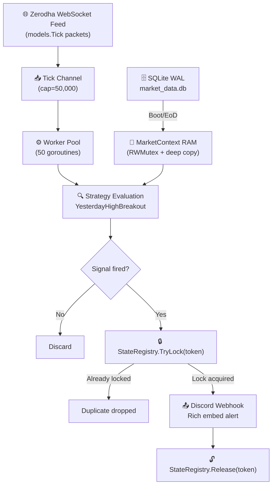

# AlgoTrader — Architecture Reference

> Production boilerplate for a low-latency Go algorithmic trading engine powered by Zerodha Kite Connect, SQLite, and Discord.

---

## Project Topology

```
algotrader/
├── cmd/engine/main.go                   # Orchestrator & OS signal lifecycle
├── internal/
│   ├── config/config.go                 # Fail-fast env var loader
│   ├── domain/
│   │   ├── models.go                    # OrderSignal, StateRegistry (TryLock/Release)
│   │   └── context.go                  # MarketContext RAM cache (RWMutex + deep copy)
│   ├── repository/database.go          # SQLite: WAL mode, schema, LoadHistory, DropOldData
│   ├── scheduler/cron.go               # Embedded cron: 08:45 boot + 15:45 EoD rollup (Mon–Fri)
│   ├── service/
│   │   ├── bootloader.go               # SQLite-first boot with 500ms API rate limiter
│   │   └── processor.go                # 50-worker concurrent tick evaluation pipeline
│   ├── strategy/
│   │   ├── strategy.go                 # Unified Strategy interface
│   │   └── breakout.go                 # YesterdayHighBreakout implementation
│   └── transport/discord/client.go     # Discord webhook: rich embeds for signals & alerts
├── .env.example                        # Environment variable template
├── go.mod
└── go.sum
```

---

## Runtime Data Flow



---

## Key Design Decisions

| Concern | Decision |
|---|---|
| **Tick type** | `models.Tick` from `gokiteconnect/v4/models` — binary packet type delivered by OnTick callbacks |
| **Historical type** | `kiteconnect.HistoricalData` from the root package — used in RAM cache and SQLite layer |
| **Concurrency guard** | `StateRegistry.TryLock()` uses write-lock + map — exactly-once signal dispatch per breakout per token |
| **Cache safety** | `MarketContext.Get()` returns a **deep copy** — strategy goroutines cannot corrupt the master dataset |
| **DB durability** | SQLite WAL mode + `_synchronous=NORMAL` — high write throughput with crash safety |
| **Rate limiting** | `time.NewTicker(500ms)` between API calls in bootloader — consistent gap regardless of DB load time |
| **Graceful shutdown** | 4-step reverse teardown: WebSocket → Cron → Workers → DB |

---

## Scheduler Jobs

| Crontab | Time (Local) | Weekdays | Action |
|---|---|---|---|
| `45 8 * * 1-5` | 08:45 AM | Mon–Fri | Morning Boot: SQLite → RAM cache |
| `45 15 * * 1-5` | 03:45 PM | Mon–Fri | EoD Rollup: fetch today's candle → SQLite + RAM → purge >3yr |

---

## Prerequisite: 64-bit GCC for CGo (Windows)

`go-sqlite3` requires CGo. The system currently has a 32-bit MinGW GCC (6.3.0) which cannot build 64-bit binaries.

Install a 64-bit GCC toolchain before running `go build`:

**Option A — TDM-GCC (recommended):**
https://jmeubank.github.io/tdm-gcc/download/
Install the `tdm64-gcc` bundle and ensure its `gcc.exe` is first in PATH.

**Option B — MSYS2 MinGW-w64:**
```powershell
# After installing MSYS2 from https://www.msys2.org/
pacman -S mingw-w64-x86_64-gcc
# Add C:\msys64\mingw64\bin to PATH
```

**Verify:**
```powershell
gcc --version   # Must show x86_64 / mingw-w64
```

**Build:**
```powershell
$env:GOPATH = "C:\vsc\gopath"
$env:GOMODCACHE = "C:\vsc\gopath\pkg\mod"
go build -o algotrader.exe ./cmd/engine
```

---

## Running the Engine

```powershell
# 1. Populate the env file
Copy-Item .env.example .env
# Edit .env with your credentials

# 2. Load env vars in PowerShell
Get-Content .env | ForEach-Object {
    if ($_ -match '^\s*([^#][^=]+)=(.*)$') {
        [System.Environment]::SetEnvironmentVariable($matches[1].Trim(), $matches[2].Trim())
    }
}

# 3. Run
.\algotrader.exe
```

---

## Backtesting

`cmd/backtest` replays the daily candles in SQLite through the **live** `Strategy`
implementations and reports forward returns and win rate at 1D / 5D / 1M / 3M.

It needs no changes to strategy code: with `MarketContext.Intraday` empty, every
strategy already takes its closed-market branch and treats the last candle in the
slice as "today". Feeding it a growing prefix of history reproduces exactly what
the strategy saw on the evening of each session — no look-ahead.

```powershell
.\backtest.exe                                    # Ichimoku, Nifty 500, full history
.\backtest.exe -strategy rsi                      # RSI instead
.\backtest.exe -strategy all -universe all        # both strategies, every DB token
.\backtest.exe -from 2024-01-01 -cost 20          # windowed, 20 bps round-trip cost
.\backtest.exe -horizons 1D:1,2W:10,6M:126        # custom holding periods
```

| Concern | Decision |
|---|---|
| **Entry price** | Signal session's **close** — the first price obtainable once an EoD signal exists |
| **Exit price** | Close `N` sessions later; horizons count **trading sessions**, not calendar days |
| **Direction** | Inferred from `OrderSignal.StrategyName` — SELL/BEARISH/DEATH ⇒ short, else long |
| **Strategy state** | A fresh instance per token, so RSI's range-shift machine never leaks across instruments |
| **Corporate actions** | `-max-move` (default 60%) drops legs that are unadjusted splits/bonuses, not returns |
| **DB access** | Opened `mode=ro` — a replay can run while the live engine holds the file |

### Confluence report

`-confluence` adds a third report covering stocks where **every** selected
strategy signalled the **same side** within `-confluence-window` sessions
(default 5). Entry is the *last* of the agreeing signals — the first moment a
trader could have known they were aligned — and that signal's forward legs are
reused, so the numbers are directly comparable to the standalone reports.
Setups where the strategies disagree on direction are excluded and counted as
conflicts. `-confluence-cooldown` (default 5) stops a cluster of daily re-fires
becoming near-identical overlapping entries.

```powershell
.\backtest.exe -strategy all -universe all -cost 20 -confluence
```

Outputs land in `-out` (default `backtest_out/`): a text report, `_trades.csv`
(one row per signal with per-horizon return, MFE and MAE) and `_summary.csv`
(long-format stats per group × horizon). Symbol names come from the Kite
instrument master when credentials are set, and are cached to
`backtest_symbols.csv` so later runs are fully offline.

---

## Adding a New Strategy

1. Create `internal/strategy/my_strategy.go`
2. Implement the `Strategy` interface:
   ```go
   type MyStrategy struct{}
   func (s *MyStrategy) Name() string { return "MyStrategy" }
   func (s *MyStrategy) Evaluate(tick models.Tick, ctx *domain.MarketContext) (bool, domain.OrderSignal) {
       candles, ok := ctx.Get(tick.InstrumentToken) // returns deep copy
       if !ok { return false, domain.OrderSignal{} }
       // ... decision logic ...
       return true, signal
   }
   ```
3. Register in `cmd/engine/main.go`:
   ```go
   proc.RegisterStrategy(strategy.NewMyStrategy(...))
   ```
